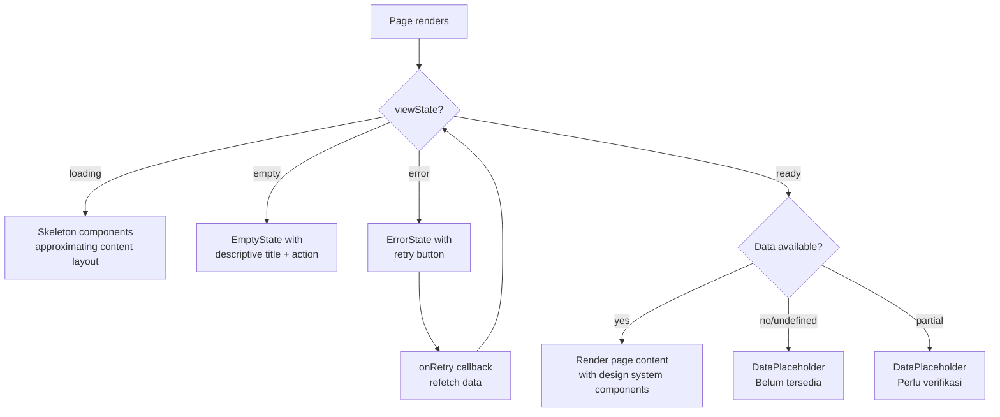

# Design Document: UI/UX Improvement

## Overview

This design document describes the technical approach for unifying all pharmacist-facing pages of the PrioMed-Rec web application under the existing design system in `web/src/uiux/`. The application currently operates with a dual UI system:

1. **Design system** (`web/src/uiux/`): Used by `WorklistPage` and `CasePage` via `pages.tsx`. Contains tokens (`tokens.css`), primitives (`primitives.tsx`), clinical components (`clinical.tsx`), and layout (`layout.tsx`).
2. **Legacy component library** (`web/src/components/ui.tsx`, `components/clinical.tsx`, `components/TierBadge.tsx`): Used by `DashboardPage`, `AuditLogPage`, `AuditLogPageV2`, `SettingsPage`, `CommandCenterPage`, `PatientAnalysisPage`, and `ReviewConfirmationPage`.
3. **Plain HTML**: Used by `LoginPage` with no design system at all.

The design goal is to migrate all pages to use the `uiux/` design system exclusively, improve visual hierarchy for clinical data, strengthen accessibility (WCAG 2.1 AA), standardize loading/empty/error states, and add responsive design patterns — all without changing any backend, API contracts, routing, state management, or business logic.

### Key Design Decisions

| Decision | Rationale |
|----------|-----------|
| Migrate pages incrementally, one page at a time | Per Requirement 13.7, changes must be reviewable independently |
| Do NOT delete legacy files (`components/ui.tsx`, `components/TierBadge.tsx`, `components/clinical.tsx`) | Per Requirement 13.1, no existing files may be deleted |
| Use existing `uiux/` primitives as-is; no new primitives needed for core migration | The design system already has all required components (Badge, Button, Card, Input, Select, Textarea, Field, Tabs, Modal, InlineAlert, EmptyState, ErrorState, Skeleton, SkipLink) |
| Reconcile SLA targets to use `SLA_TARGETS` from `clinical.tsx` as single source of truth | DashboardPage currently defines its own `getSlaTarget` with different values (HIGH:2h, MEDIUM:8h vs clinical.tsx HIGH:4h, MEDIUM:12h) |
| Add new `ShapContributionList` component to `clinical.tsx` for SHAP display | No existing component renders SHAP contributions with the required visual bar + direction indicator |
| Add `NotFoundState` component to `pages.tsx` for 404 handling | App.tsx state-based routing has no 404 fallback; need a component that renders within AppShell |
| Keep `PatientAnalysisPage` as a secondary view; `CasePage` in `pages.tsx` is the primary case workspace | App.tsx routes "worklist" and "queue" pages to CasePage when a V1 item is selected; PatientAnalysisPage is reached via "analysis" page state |

## Architecture

### Constraint: No Architecture Changes

Per Requirement 13, this feature does NOT modify:
- Backend FastAPI endpoints, request/response structures, ML models, rule engine logic, LLM service calls, or database schema
- State-based routing in `App.tsx` (page state via `useState`, not react-router)
- Zustand auth store
- React framework, Tailwind CSS, TanStack Query, Zustand, or Vite build system
- Pharmacist workflow order: worklist → patient detail → review

The architecture remains identical to the current state. The only changes are import paths and JSX element swaps within existing page components.

### Current Architecture (Unchanged)

```mermaid
graph TB
    subgraph "App.tsx (State-based routing)"
        Auth{isAuthenticated?}
        LoginPage[LoginPage]
        AppShell[AppShell - uiux/layout.tsx]
        PageRouter[Page Router: useState PageId]
    end

    subgraph "uiux/ Design System (Target)"
        Tokens[tokens.css]
        Primitives[primitives.tsx<br/>Badge, Button, Card, Input,<br/>Select, Textarea, Field, Tabs,<br/>Modal, InlineAlert, EmptyState,<br/>ErrorState, Skeleton, SkipLink]
        Clinical[clinical.tsx<br/>PriorityBadge, WorkflowStatusBadge,<br/>KpiCard, FindingCard, AiDraftNotice,<br/>SafetyBanner, RiskScoreBar, SlaIndicator,<br/>AuditTimeline, SectionHeading, HighAlertDialog,<br/>PatientIdentity, ReasonChip, SourceTag]
        Layout[layout.tsx<br/>AppShell with sidebar + topbar + safety strip]
        Pages[pages.tsx<br/>WorklistPage, CasePage]
    end

    subgraph "Legacy Components (To be migrated away from)"
        LegacyUI[components/ui.tsx<br/>Heading, Button, Card, Badge,<br/>Input, Select, Textarea, Field,<br/>Modal, EmptyState, ErrorState,<br/>PageSkeleton, Skeleton]
        LegacyClinical[components/clinical.tsx<br/>PriorityBadge, StatusBadge,<br/>VerificationNotice, KpiCard,<br/>PatientSummary, RiskContributionChart,<br/>AppShell (legacy)]
        TierBadge[components/TierBadge.tsx]
    end

    subgraph "Pages (Migration Targets)"
        Login[LoginPage.tsx]
        Dashboard[DashboardPage.tsx]
        Worklist[WorklistPage in pages.tsx]
        CasePage[CasePage in pages.tsx]
        Analysis[PatientAnalysisPage.tsx]
        Audit[AuditLogPage.tsx]
        AuditV2[AuditLogPageV2.tsx]
        Settings[SettingsPage.tsx]
        CommandCenter[CommandCenterPage.tsx]
        ReviewConfirm[ReviewConfirmationPage.tsx]
    end

    Auth -->|No| LoginPage
    Auth -->|Yes| AppShell
    AppShell --> PageRouter
    PageRouter --> Login
    PageRouter --> Dashboard
    PageRouter --> Worklist
    PageRouter --> CasePage
    PageRouter --> Analysis
    PageRouter --> Audit
    PageRouter --> AuditV2
    PageRouter --> Settings
    PageRouter --> CommandCenter
    PageRouter --> ReviewConfirm

    Login -.->|Currently: plain HTML| LegacyUI
    Dashboard -.->|Currently: legacy| LegacyUI
    Dashboard -.->|Currently: legacy| TierBadge
    Audit -.->|Currently: legacy| LegacyUI
    AuditV2 -.->|Currently: legacy| LegacyUI
    Settings -.->|Currently: legacy| LegacyUI
    CommandCenter -.->|Currently: legacy| LegacyUI
    CommandCenter -.->|Currently: legacy| TierBadge
    Analysis -.->|Currently: legacy| LegacyUI
    Analysis -.->|Currently: legacy| LegacyClinical
    ReviewConfirm -.->|Currently: legacy| LegacyUI

    Worklist -->|Already uses| Primitives
    Worklist -->|Already uses| Clinical
    Worklist -->|Already uses| Pages
    CasePage -->|Already uses| Primitives
    CasePage -->|Already uses| Clinical
```

### Migration Flow

```mermaid
flowchart LR
    subgraph "Phase 1: Login"
        L1[LoginPage.tsx<br/>Replace plain HTML<br/>with uiux/ primitives]
    end

    subgraph "Phase 2: Dashboard"
        D1[DashboardPage.tsx<br/>Replace legacy KpiCard,<br/>SystemHealthDot, TierBadge<br/>with uiux/ components]
    end

    subgraph "Phase 3: Worklist Enhancement"
        W1[pages.tsx WorklistTable<br/>Add high-alert badge<br/>Enforce 7-column max]
    end

    subgraph "Phase 4: CasePage Enhancement"
        C1[pages.tsx CasePage<br/>Ensure 5-tab structure<br/>Persistent header<br/>Med comparison only when active]
    end

    subgraph "Phase 5: Risk & SHAP"
        R1[clinical.tsx<br/>Add ShapContributionList<br/>PatientAnalysisPage.tsx<br/>Use RiskScoreBar + ShapContributionList]
    end

    subgraph "Phase 6: Review Form"
        RF1[pages.tsx CasePage Review tab<br/>4 decision buttons<br/>Required note logic<br/>InlineAlert feedback<br/>Escalation sub-form]
    end

    subgraph "Phase 7: Audit Pages"
        A1[AuditLogPage.tsx<br/>Migrate to uiux/ primitives<br/>Add action badges with icons]
        A2[AuditLogPageV2.tsx<br/>Same migration as A1]
    end

    subgraph "Phase 8: States & 404"
        S1[Standardize Skeleton/<br/>EmptyState/ErrorState<br/>Add NotFoundState<br/>Data placeholder rules]
    end

    subgraph "Phase 9: Supporting Pages"
        SP1[SettingsPage.tsx<br/>CommandCenterPage.tsx<br/>ReviewConfirmationPage.tsx<br/>Migrate to uiux/ primitives]
    end

    subgraph "Phase 10: Accessibility & Responsive"
        AR1[44px targets, focus rings,<br/>SkipLink on all pages,<br/>keyboard tab nav,<br/>modal focus trap,<br/>responsive breakpoints]
    end

    L1 --> D1 --> W1 --> C1 --> R1 --> RF1 --> A1 --> A2 --> S1 --> SP1 --> AR1
```



### Component Dependency Graph (Post-Migration)

```mermaid
graph TD
    subgraph "tokens.css"
        T[Color, Font, Radius, Shadow,<br/>Focus tokens]
    end

    subgraph "primitives.tsx"
        P_Badge[Badge]
        P_Button[Button]
        P_Card[Card]
        P_Input[Input]
        P_Select[Select]
        P_Textarea[Textarea]
        P_Field[Field]
        P_Tabs[Tabs]
        P_SegmentedControl[SegmentedControl]
        P_Modal[Modal]
        P_InlineAlert[InlineAlert]
        P_EmptyState[EmptyState]
        P_ErrorState[ErrorState]
        P_Skeleton[Skeleton]
        P_SkipLink[SkipLink]
        P_IconButton[IconButton]
    end

    subgraph "clinical.tsx"
        C_PriorityBadge[PriorityBadge]
        C_WorkflowBadge[WorkflowStatusBadge]
        C_KpiCard[KpiCard]
        C_FindingCard[FindingCard]
        C_AiDraft[AiDraftNotice]
        C_SafetyBanner[SafetyBanner]
        C_RiskBar[RiskScoreBar]
        C_SlaInd[SlaIndicator]
        C_AuditTimeline[AuditTimeline]
        C_SectionHeading[SectionHeading]
        C_HighAlertDialog[HighAlertDialog]
        C_PatientIdentity[PatientIdentity]
        C_ReasonChip[ReasonChip]
        C_SourceTag[SourceTag]
        C_ShapList[ShapContributionList<br/>NEW]
        C_DataPlaceholder[DataPlaceholder<br/>NEW]
    end

    subgraph "layout.tsx"
        L_AppShell[AppShell]
        L_Brand[Brand]
        L_NavList[NavList]
        L_SafetyNote[SafetyNote]
    end

    subgraph "pages.tsx"
        PG_Worklist[WorklistPage]
        PG_WorklistTable[WorklistTable]
        PG_WorklistCard[WorklistCard]
        PG_CasePage[CasePage]
        PG_NotFound[NotFoundState<br/>NEW]
    end

    T --> P_Badge & P_Button & P_Card & P_Input & P_Select & P_Textarea
    P_Badge --> C_PriorityBadge & C_WorkflowBadge & C_ReasonChip
    P_Button --> C_HighAlertDialog
    P_Card --> C_KpiCard & C_FindingCard
    P_InlineAlert --> C_AiDraft & C_SafetyBanner & C_DataPlaceholder
    P_Modal --> C_HighAlertDialog
    P_Skeleton & P_EmptyState & P_ErrorState --> PG_Worklist & PG_CasePage
    P_SkipLink --> L_AppShell

    C_PriorityBadge --> PG_WorklistTable & PG_WorklistCard & PG_CasePage
    C_SlaInd --> PG_WorklistTable & PG_WorklistCard
    C_PatientIdentity --> PG_WorklistTable & PG_WorklistCard & PG_CasePage
    C_KpiCard --> PG_Worklist
    C_FindingCard --> PG_CasePage
    C_RiskBar --> PG_CasePage
    C_ShapList --> PG_CasePage
    C_SectionHeading --> PG_Worklist & PG_CasePage
    C_AiDraft --> PG_CasePage
    C_AuditTimeline --> PG_CasePage
    C_DataPlaceholder --> PG_CasePage
```



## Components and Interfaces

### Existing Design System Components (No Changes Needed)

The following components in `uiux/primitives.tsx` already satisfy multiple requirements and need no modification:

| Component | Requirements Satisfied | Notes |
|-----------|----------------------|-------|
| `Badge` | 10.5, 2.3, 3.3, 8.5 | Supports `tone`, `icon`, `dot` props. Tones: neutral, info, success, warning, danger, critical, teal |
| `Button` | 6.1, 6.7, 1.6, 1.8 | Variants: primary, secondary, ghost, danger, success, subtle. Sizes include `lg` (min-h-12 = 48px ≥ 44px). `loading` prop shows spinner |
| `Card` | 9.6, 10.3 | Uses `rounded-xl` (14px ≈ --pmr-radius-lg). `padded` prop |
| `Input` | 1.3, 11.7 | `min-h-10` (40px). `invalid` prop for error states. Forwarded ref |
| `Select` | 7.2, 11.7 | Same styling base as Input. Note: legacy Select takes `options` prop; uiux Select takes `children` |
| `Textarea` | 6.2, 7.2 | `min-h-20`, `rows` default 3 |
| `Field` | 6.2, 7.2, 11.7 | `label`, `htmlFor`, `hint`, `error`, `required` props. Shows required indicator `*` or "(opsional)" |
| `Tabs` | 4.2, 11.5 | ArrowLeft/ArrowRight keyboard nav. `aria-selected`, `aria-controls` attributes. `TabItem` interface with `id`, `label`, `icon`, `count` |
| `Modal` | 11.8, 14.5 | Escape to close, scroll lock, focus management (`tabIndex={-1}` on panel, auto-focus on open). Backdrop click to close |
| `InlineAlert` | 1.5, 6.4, 6.5, 16.2 | Tones: neutral, info, success, warning, danger, critical, teal. `role="alert"` for danger/critical |
| `EmptyState` | 9.2, 8.4 | `title`, `description`, `icon`, `action` props. Dashed border, centered layout |
| `ErrorState` | 2.5, 9.3 | Wraps InlineAlert with danger tone. `onRetry` and `retrying` props |
| `Skeleton` | 2.4, 8.3, 9.1 | `animate-pulse`, `aria-hidden="true"` |
| `SkipLink` | 1.7, 11.6 | `sr-only` → visible on focus. Anchors to `#pmr-main` |

### Existing Clinical Components (No Changes Needed)

| Component | File | Requirements Satisfied |
|-----------|------|----------------------|
| `PriorityBadge` | clinical.tsx | 2.3, 3.3, 4.3 | Icon + text label (TINGGI/SEDANG/RENDAH via `tierMeta`), not color alone |
| `WorkflowStatusBadge` | clinical.tsx | 3.1 | Color + text label via `workflowMeta` map |
| `KpiCard` | clinical.tsx | 2.2 | Left-border accent, `font-clinical-mono` for values |
| `FindingCard` | clinical.tsx | 4.4 | Discrepancy type, medication, home vs admission, tier badge |
| `AiDraftNotice` | clinical.tsx | 4.6, 5.6, 17.1 | Warning tone, Sparkles icon, "wajib diverifikasi apoteker" text |
| `SafetyBanner` | clinical.tsx | 17.2 | Info tone, ShieldCheck icon, safety message |
| `RiskScoreBar` | clinical.tsx | 5.1 | Visual bar + numeric percentage, `role="meter"` with ARIA values |
| `SlaIndicator` | clinical.tsx | 3.5, 2.7 | Color + icon (TriangleAlert/Clock/CheckCircle2) + text. Breach = red border, warning = amber |
| `AuditTimeline` | clinical.tsx | 4.1 (History tab) | Timeline with action icons + labels + timestamps |
| `SectionHeading` | clinical.tsx | 8.2, 14.2 | Eyebrow + title + description + actions. `as="h1"` or `"h2"` |
| `HighAlertDialog` | clinical.tsx | 3.4 (related) | Hard-stop confirmation with per-item checkboxes |
| `PatientIdentity` | clinical.tsx | 3.1, 4.3 | Avatar with initials, name, patient ID, encounter, ward, DPJP |
| `ReasonChip` | clinical.tsx | 3.1 | Priority reason with source tag (ML/SLA/RULE) |
| `SourceTag` | clinical.tsx | 5.5 (related) | Source label in mono font |

### New Components to Create

#### 1. `ShapContributionList` (in `clinical.tsx`)

**Purpose**: Render SHAP feature contributions as a ranked list with visual bars showing magnitude and direction.

**Requirements**: 5.2, 5.3

```typescript
export interface ShapContribution {
  feature: string
  shap_value: number  // positive = increases risk, negative = decreases
  value?: string      // original feature value
  direction?: string   // "positive" | "negative"
}

export interface ShapContributionListProps {
  contributions: ShapContribution[]
  modelVersion?: string | null
  ruleVersion?: string | null
  className?: string
}
```

**Design**:
- Each contribution rendered as a row with: feature name (left), horizontal bar centered at zero (positive extends right in blue, negative extends left in teal), numeric value in `font-clinical-mono` (right)
- Bar width proportional to `Math.min(Math.abs(shap_value) / maxAbsValue, 1) * 48%`
- Model version and rule version displayed as labels below the list when provided
- `AiDraftNotice` included above the list
- When `contributions` is empty or null → render `DataPlaceholder` with "Belum tersedia"
- When contributions are partial (some missing values) → render `DataPlaceholder` with "Perlu verifikasi"

**Accessibility**:
- Container has `role="list"` with `aria-label`
- Each row has `role="listitem"`
- Bar has `aria-label` with feature name, direction, and value
- Direction indicated by both color AND text label ("meningkatkan"/"menurunkan")

#### 2. `DataPlaceholder` (in `clinical.tsx`)

**Purpose**: Standardized placeholder for missing or incomplete clinical data.

**Requirements**: 5.4, 9.5, 17.3, 17.4

```typescript
export type DataAvailability = "unavailable" | "needs_verification" | "available"

export interface DataPlaceholderProps {
  availability: DataAvailability
  label?: string
  className?: string
}
```

**Design**:
- `unavailable` → muted text "Belum tersedia" with Info icon, slate-50 background
- `needs_verification` → warning text "Perlu verifikasi" with TriangleAlert icon, amber-50 background
- `available` → renders children (no placeholder shown)
- Never renders blank space or empty container

#### 3. `NotFoundState` (in `pages.tsx`)

**Purpose**: 404 state for unknown page routes.

**Requirements**: 9.4

```typescript
export function NotFoundState({ onReturn }: { onReturn: () => void })
```

**Design**:
- Uses `EmptyState` from primitives with a Compass icon
- Title: "Halaman tidak ditemukan"
- Description: "Halaman yang Anda cari tidak tersedia atau telah dipindahkan."
- Action: `Button` variant "secondary" → "Kembali ke Worklist" calling `onReturn`

**Integration**: In `App.tsx`, the page router currently handles known `PageId` values. A 404 state would be rendered when the `page` state somehow holds an invalid value (edge case during development). More practically, this component is also useful for deep-link scenarios where `selectedV1Item` is null but the user navigates to a case view. The `NotFoundState` renders inside `AppShell` as the `children` content.

### Page-by-Page Migration Design

#### LoginPage.tsx (Requirement 1)

**Current state**: Plain HTML elements, emoji 💊 icon, inline styles.

**Migration changes**:

| Current | Target | Requirement |
|---------|--------|-------------|
| `<div className="min-h-screen flex items-center justify-center bg-slate-50">` | `<div className="min-h-screen flex items-center justify-center bg-[var(--pmr-bg)]">` | 1.1 |
| `<span className="text-2xl">💊</span>` | `<div className="flex size-10 items-center justify-center rounded-xl bg-gradient-to-br from-cyan-400 to-blue-600 text-white shadow-lg"><HeartPulse className="size-5" /></div>` (matching AppShell Brand) | 1.2 |
| `<h1 className="text-xl font-bold text-slate-800">` | `<h1 className="font-display text-xl font-bold text-slate-900">` | 1.1 |
| `<input type="text" ...>` | `<Field label="Username" htmlFor="login-username" required><Input id="login-username" ... /></Field>` | 1.3, 11.7 |
| `<input type="password" ...>` | `<Field label="Password" htmlFor="login-password" required><Input id="login-password" type="password" ... /></Field>` | 1.3, 11.7 |
| `<div className="p-3 bg-red-50 ...">` (error) | `<InlineAlert tone="danger" title="Gagal masuk">{error}</InlineAlert>` | 1.5 |
| `<button type="submit" disabled={loading}>` | `<Button type="submit" size="lg" loading={loading}>Masuk</Button>` | 1.6, 1.8 |
| No SkipLink | `<SkipLink />` at top of page | 1.7 |
| No safety notice | `<SafetyBanner compact />` below the form | 1.4 |

**Preserved behavior**: `handleSubmit` function, `loginApi` call, `useAuthStore` login, `onSuccess` callback — all unchanged.

#### DashboardPage.tsx (Requirement 2)

**Current state**: Legacy `KpiCard` (local function), `SystemHealthDot` (local function), `TierBadge` from `components/TierBadge.tsx`, `animate-pulse` divs for loading, plain error div.

**Migration changes**:

| Current | Target | Requirement |
|---------|--------|-------------|
| Local `KpiCard` function | `KpiCard` from `uiux/clinical.tsx` | 2.2 |
| Local `SystemHealthDot` | Keep as local but enhance: add `aria-label` with both color name and text ("OK"/"Error"), use Badge with `dot` prop instead of bare span | 2.6 |
| `TierBadge` import from `components/TierBadge.tsx` | `PriorityBadge` from `uiux/clinical.tsx` | 2.3 |
| `animate-pulse` divs for KPI loading | `Skeleton` from `uiux/primitives.tsx` approximating KPI card layout | 2.4 |
| `<div className="p-4 bg-red-50 ...">` error div | `ErrorState` from `uiux/primitives.tsx` with `onRetry` | 2.5 |
| SLA bar colors: `bg-red-500`, `bg-yellow-400`, `bg-green-400` | `bg-red-600` (--pmr-critical), `bg-amber-500` (--pmr-warning), `bg-emerald-600` (--pmr-success) | 2.7 |
| Local `getSlaTarget` (HIGH:2h, MEDIUM:8h) | Use `SLA_TARGETS` and `isSlaBreached` from `uiux/clinical.tsx` | 2.7, consistency |
| `Heading` from `components/ui.tsx` | `SectionHeading` from `uiux/clinical.tsx` | 10.6 |
| `Button` from `components/ui.tsx` | `Button` from `uiux/primitives.tsx` | 10.6 |
| `Card` from `components/ui.tsx` | `Card` from `uiux/primitives.tsx` | 10.6 |
| `Badge` from `components/ui.tsx` | `Badge` from `uiux/primitives.tsx` | 10.6 |

**SLA Reconciliation**: The DashboardPage's local `getSlaTarget` uses HIGH:2h/MEDIUM:8h/LOW:24h, while `clinical.tsx` SLA_TARGETS uses HIGH:4h/MEDIUM:12h/LOW:24h. The design system values are used by WorklistPage and CasePage already. To maintain consistency, DashboardPage will import `SLA_TARGETS`, `isSlaBreached`, and `slaTargetHours` from `clinical.tsx` instead of defining its own. This aligns the SLA display across all pages.

**Preserved behavior**: TanStack Query hooks (`useQuery` for worklist and health), refetch interval, all data processing logic.

#### WorklistPage / WorklistTable (Requirement 3)

**Current state**: Already uses `uiux/` design system. WorklistTable has 7 columns.

**Enhancement changes**:

| Current | Target | Requirement |
|---------|--------|-------------|
| 7 columns: Prioritas, Pasien, Bangsal/DPJP, Status, SLA, Alasan, Aksi | Verify max 7 columns. Current layout already has exactly 7. No change needed. | 3.6 |
| Risk score in PriorityBadge | Add `font-clinical-mono` to the ML percentage in PriorityBadge (already uses `font-clinical-mono` for the percentage text) | 3.2 |
| PriorityBadge shows "Prioritas tinggi/sedang/rendah" | Add Indonesian short labels: the `tierMeta` already uses "Prioritas tinggi/sedang/rendah" for full and strips "Prioritas " for compact. Consider adding explicit "TINGGI"/"SEDANG"/"RENDAH" labels for compact mode to match requirement 3.3 | 3.3 |
| No high-alert indicator in row | Add `AlertTriangle` badge with count when `priority_reasons` contains "high-alert" pattern. Position after SLA indicator. | 3.4 |
| SLA indicator already uses red border + clock icon for breach | Already satisfies 3.5 via `SlaIndicator` with `TriangleAlert` icon and red border for breach | 3.5 |
| Card layout for mobile already exists (`WorklistCard`) | Verify priority badge and risk score are at the top of each card. Current `WorklistCard` already has `<PriorityBadge>` and `<SlaIndicator>` at the top. | 3.7 |

**Column order** (Requirement 3.1): The current table order is Prioritas, Pasien, Bangsal/DPJP, Status, SLA, Alasan, Aksi. The requirement specifies: priority tier badge, risk score, patient identity, top risk reason, SLA indicator, workflow status. The risk score is currently embedded in PriorityBadge. To satisfy 3.1 more precisely, the PriorityBadge column header could be "Prioritas & Skor" and the badge already shows both. The order is close but "Alasan" (reason) comes before SLA in the current layout vs after patient identity in the requirement. This is a minor reordering — the table already groups priority+score together. The design keeps the current order since it already satisfies the visual hierarchy: priority badge (with score) → patient identity → ward/DPJP → status → SLA → reasons → action.

#### CasePage (Requirement 4)

**Current state**: Already uses `uiux/` design system with `Tabs` component. Has tabs for Findings, Medication Comparison, SBAR Draft, Review, History.

**Enhancement changes**:

| Current | Target | Requirement |
|---------|--------|-------------|
| Tabs: findings, compare, sbar, review, history | Verify exactly 5 tabs: Findings, Medication Comparison, SBAR Draft, Review, History. Current `CasePage` already has these tabs in `pages.tsx`. | 4.1 |
| Tabs component from `primitives.tsx` with ArrowLeft/ArrowRight | Already satisfies 4.2 | 4.2 |
| Patient identity, priority badge, risk score in header | Verify persistent header. Current CasePage has a header section with `PatientIdentity`, `PriorityBadge`, `RiskScoreBar` before the tabs. | 4.3 |
| Findings tab renders `FindingCard` components | Already satisfies 4.4. `FindingCard` shows discrepancy type, medication, home vs admission, tier badge | 4.4 |
| Discrepancy labels in `DISCREPANCY_LABEL` map | Verify labels: "Potensi obat terlewat" (OMISSION), "Kemungkinan substitusi" (SUBSTITUTION), "Potensi duplikasi" (DUPLICATION), "Padanan belum pasti" (UNRESOLVED). Requirement 4.5 specifies "OMISSION", "SUBSTITUTION", "DUPLICATION", "UNRESOLVED" — the current Indonesian labels satisfy this with consistent terminology. | 4.5 |
| SBAR Draft tab with AiDraftNotice | Verify AiDraftNotice is shown. Current CasePage includes `AiDraftNotice` in the SBAR section. | 4.6 |
| SBAR disclaimer about pharmacist verification and DPJP | Add explicit disclaimer text: "Apoteker wajib memverifikasi konten ini. Keputusan terapi akhir tetap berada pada DPJP." This can be added as an additional `InlineAlert` or as text within the AiDraftNotice `detail` prop. | 4.7 |
| Medication Comparison tab renders side-by-side | Verify that the comparison view only renders when the compare tab is active. Current implementation uses conditional rendering based on `activeTab === "compare"`. The `MedComparisonPanel` component should not be rendered or precomputed outside the active tab. | 4.8 |

**Design for 4.8**: The CasePage already uses a tab-based conditional rendering pattern (`{activeTab === "findings" && <FindingsPanel />}`). The Medication Comparison panel must follow the same pattern — only rendered when `activeTab === "compare"`. No precomputation of comparison data should occur when the tab is inactive. The `useMemo` for comparison data should be conditioned on `activeTab === "compare"` or the comparison function should be called lazily within the panel render.

#### PatientAnalysisPage.tsx (Requirement 5)

**Current state**: Uses legacy `components/ui.tsx` and `components/clinical.tsx`. Has `RiskContributionChart` from legacy clinical, `PriorityBadge` (legacy), `VerificationNotice`, `PatientSummary`.

**Migration changes**:

| Current | Target | Requirement |
|---------|--------|-------------|
| Legacy `RiskContributionChart` | `RiskScoreBar` + new `ShapContributionList` from `uiux/clinical.tsx` | 5.1, 5.2 |
| `font-mono` for contribution values | `font-clinical-mono` utility class | 5.3 |
| Missing SHAP → blank/empty section | `DataPlaceholder` with "Belum tersedia" or "Perlu verifikasi" | 5.4 |
| No model version display | Add model version and rule version labels from API response (`res.model_version`, `res.rule_version`) | 5.5 |
| Legacy `VerificationNotice kind="ml"` | `AiDraftNotice` from `uiux/clinical.tsx` | 5.6 |
| Legacy `PriorityBadge` | `PriorityBadge` from `uiux/clinical.tsx` | 10.6 |
| Legacy `StatusBadge` | `WorkflowStatusBadge` from `uiux/clinical.tsx` | 10.6 |
| Legacy `PatientSummary` | `PatientIdentity` from `uiux/clinical.tsx` | 10.6 |
| Legacy `Card`, `Button`, `Badge`, `Heading`, `Input`, `Textarea`, `Field`, `Modal`, `EmptyState`, `ErrorState`, `PageSkeleton`, `Checkbox` | Equivalent from `uiux/primitives.tsx` | 10.6 |

**Preserved behavior**: `analyzePatient` API call, `checkSafetyFlags` API call, `onDecision` callback, `onUpdatePatient` callback, discrepancy status update, SBAR copy, safety flag display, interaction review.

#### Review Form in CasePage (Requirement 6)

**Current state**: CasePage's Review tab has a review form with decision buttons.

**Migration changes**:

| Current | Target | Requirement |
|---------|--------|-------------|
| Decision buttons: APPROVE (success), REJECT (danger), EDIT (primary/blue), ESCALATE (secondary) | Verify 4 buttons: APPROVE (green/success), REJECT (red/danger), EDIT (blue/info → use `primary` variant which is blue), ESCALATE (amber/warning → add `warning` variant to Button or use a custom className). Currently ESCALATE uses `secondary` variant. | 6.1 |
| Note input: `<Input>` for decision note | `<Field>` + `<Textarea>` when action is REJECT or ESCALATE (required). For APPROVE and EDIT, note is optional. | 6.2 |
| `submitReviewV1` call | Verify existing call passes `pharmacist_note` parameter. Current `submitReviewV1` already accepts note parameter. | 6.3 |
| Success feedback: `FeedbackBanner` with InlineAlert | Verify `InlineAlert` with tone "success" is shown on success. Current `FeedbackBanner` already uses `InlineAlert`. | 6.4 |
| Error feedback: `FeedbackBanner` with InlineAlert danger | Verify `InlineAlert` with tone "danger" and specific error message. | 6.5 |
| Disclaimer about pharmacist decision being final | Add `SafetyBanner` or inline text: "Keputusan apoteker bersifat final. Output AI bersifat advisori saja." | 6.6 |
| Submit button while loading | Verify Button `loading` prop disables and shows spinner. Current `Button` already supports `loading` prop. | 6.7 |

**Button variant for ESCALATE (Requirement 6.1)**: The current `Button` variants are: primary, secondary, ghost, danger, success, subtle. There is no "warning" variant. Two options:
1. Add a `warning` variant to Button in `primitives.tsx` (amber styling)
2. Use `secondary` variant with custom className for amber color

**Design decision**: Add a `warning` variant to `Button` in `primitives.tsx` with styling: `border-transparent bg-amber-600 text-white shadow-sm hover:bg-amber-700 active:bg-amber-800`. This is a minimal addition to the existing variant map and doesn't change any existing variant behavior.

#### Escalation Form (Requirement 7)

**Current state**: CasePage's Review tab handles ESCALATE action through the same decision flow.

**Migration changes**:

| Current | Target | Requirement |
|---------|--------|-------------|
| No dedicated escalation form | When ESCALATE is selected, show escalation sub-form with required reason field and optional target recipient Select | 7.1 |
| N/A | Use `Field`, `Select`, `Textarea` from `primitives.tsx` | 7.2 |
| `submitReviewV1` with action "ESCALATE" | Verify existing call. The `submitReviewV1` function accepts `ReviewAction` type which includes "ESCALATE". Pass escalation reason in `pharmacist_note` field. | 7.3 |
| No confirmation message | After successful escalation, show `InlineAlert` tone "success": "Kasus telah dieskalasi. DPJP akan diberi tahu." | 7.4 |
| Priority tier may be changed | Verify escalation does NOT modify `latest_tier`. The `submitReviewV1` call should only record the action, not change the tier. Current implementation doesn't change tier. | 7.5 |

**Escalation form design**: When the pharmacist clicks ESCALATE, instead of immediately showing the decision confirmation modal, show an inline form within the Review tab:
- `Field` label "Alasan eskalasi" (required) → `Textarea`
- `Field` label "Penerima eskalasi" (optional) → `Select` with options: "DPJP (otomatis)", "Apoteker senior", "Koordinator farmasi"
- Submit button calls `submitReviewV1` with action "ESCALATE" and reason in `pharmacist_note`
- On success, show `InlineAlert` tone "success" with confirmation message
- The patient's `latest_tier` remains unchanged

#### AuditLogPage.tsx (Requirement 8)

**Current state**: Uses legacy `components/ui.tsx` (Badge, Button, Card, EmptyState, ErrorState, Heading, Input, PageSkeleton, Select).

**Migration changes**:

| Current | Target | Requirement |
|---------|--------|-------------|
| `Heading` from `components/ui.tsx` | `SectionHeading` from `uiux/clinical.tsx` | 8.2 |
| `PageSkeleton type="table"` for loading | `Skeleton` from `uiux/primitives.tsx` approximating table row layout | 8.3 |
| `EmptyState` from `components/ui.tsx` | `EmptyState` from `uiux/primitives.tsx` with reset filter action | 8.4 |
| `ErrorState` from `components/ui.tsx` | `ErrorState` from `uiux/primitives.tsx` | 8.1 |
| Badge with color only for action | Badge with color + icon + text: APPROVE → green + CheckCircle2, REJECT → red + XCircle, EDIT → blue + Pencil | 8.5 |
| `font-mono` for timestamps | `font-clinical-mono` for timestamps | 8.6 |
| Filter controls (search, date, action) | Preserve existing behavior and API calls. Only swap component imports. | 8.7 |
| Legacy `Input`, `Select`, `Button`, `Card`, `Badge` | Equivalent from `uiux/primitives.tsx` | 8.1 |

**Note on Select API difference**: Legacy `Select` takes `options` prop (array of `{value, label}`). The `uiux/` `Select` takes `children` (option elements). Migration requires changing `<Select options={[...]} />` to `<Select><option value="...">label</option></Select>`.

#### AuditLogPageV2.tsx (Requirement 8.8)

**Current state**: Uses plain HTML elements and inline styles. Has `verifyAuditChain` mutation, `ACTION_COLORS` map.

**Migration changes**: Same design system alignment as AuditLogPage. Replace inline-styled elements with `uiux/primitives.tsx` components. Replace `ACTION_COLORS` map with `Badge` tones + icons. Use `Skeleton` for loading, `EmptyState` for empty, `ErrorState` for error. Preserve `verifyAuditChain` mutation and all existing behavior.

#### Loading, Empty, Error, and 404 States (Requirement 9)

**Design**: Create a standardized `ViewState` rendering pattern.

**Loading state pattern** (9.1):
```tsx
if (viewState === "loading") {
  return (
    <div className="space-y-4">
      <Skeleton className="h-8 w-64" />  {/* Heading skeleton */}
      <div className="grid gap-3 sm:grid-cols-2 xl:grid-cols-4">
        {[0,1,2,3].map(i => (
          <Card key={i} className="space-y-2">
            <Skeleton className="h-3 w-24" />
            <Skeleton className="h-7 w-16" />
            <Skeleton className="h-3 w-32" />
          </Card>
        ))}
      </div>
      <Card className="space-y-3">
        {[0,1,2,3,4].map(i => (
          <div key={i} className="flex items-center gap-4">
            <Skeleton className="size-9 rounded-lg" />
            <Skeleton className="h-4 flex-1" />
            <Skeleton className="h-8 w-24" />
          </div>
        ))}
      </Card>
    </div>
  )
}
```

**Empty state pattern** (9.2):
```tsx
if (viewState === "empty") {
  return (
    <EmptyState
      icon={<ClipboardList className="size-5" />}
      title="Tidak ada kasus pada filter ini"
      description="Ubah filter atau hapus kata kunci pencarian."
      action={<Button variant="secondary" onClick={resetFilters}>Reset filter</Button>}
    />
  )
}
```

**Error state pattern** (9.3):
```tsx
if (viewState === "error") {
  return (
    <ErrorState
      description="Data tidak dapat dimuat. Periksa koneksi lalu coba lagi."
      onRetry={() => refetch()}
      retrying={isFetching}
    />
  )
}
```

**404 state pattern** (9.4):
```tsx
// In App.tsx, when selectedV1Item is null but user navigates to case view:
{page === "worklist" && selectedV1Item === null && <WorklistPage ... />}
// If an unknown page state is encountered:
<NotFoundState onReturn={() => setPage("worklist")} />
```

**Data placeholder rules** (9.5):
- `DataPlaceholder availability="unavailable"` → "Belum tersedia" (never captured)
- `DataPlaceholder availability="needs_verification"` → "Perlu verifikasi" (exists but needs confirmation)
- Never render blank space, empty containers, or placeholder symbols like "—" for clinical data sections

**Visual consistency** (9.6): All states use `Card` with `rounded-xl` (14px ≈ --pmr-radius-lg) and `shadow-sm` (--pmr-shadow-sm). `EmptyState` uses dashed border variant. `ErrorState` uses InlineAlert within a Card-like container. `Skeleton` uses `rounded-md` within Card containers.

#### Design System Consistency (Requirement 10)

**Alert color hierarchy** (10.1):
| Status | Token | Tailwind Class | Usage |
|--------|------|---------------|-------|
| Critical | --pmr-critical (#b91c1c) | `bg-red-600`, `text-red-600` | SLA breach, HIGH priority |
| High/Warning | --pmr-warning (#b45309) | `bg-amber-500`, `text-amber-600` | SLA warning, MEDIUM priority |
| Success | --pmr-success (#047857) | `bg-emerald-600`, `text-emerald-600` | SLA OK, LOW priority, approved |
| Info | --pmr-info (#1d4ed8) | `bg-blue-600`, `text-blue-600` | EDIT action, informational |

Note: The requirement mentions "high/orange-600" but the existing design system uses amber-500 for warning. The design standardizes on the existing token values rather than introducing orange-600.

**Typography** (10.2):
- `font-display` (Plus Jakarta Sans): All page headings (h1-h4), SectionHeading title
- `font-clinical-mono` (JetBrains Mono with tabular-nums): Risk scores, SLA values, timestamps, audit timestamps, SHAP contribution values, medication versions, model/rule versions

**Border radius** (10.3):
- `--pmr-radius` (10px): Inputs, buttons, Select, Textarea → `rounded-lg`
- `--pmr-radius-lg` (14px): Cards → `rounded-xl`
- `--pmr-radius-xl` (18px): Modals → `rounded-2xl`

**Spacing** (10.4): Tailwind scale 1/2/3/4/6/8 = 4/8/12/16/24/32px. Already used consistently throughout the design system.

**Badge tones** (10.5): The `uiux/` Badge supports: neutral, info, success, warning, danger, critical, teal. All pages use these same tones.

**Legacy import replacement** (10.6): All pages currently importing from `components/ui.tsx` will replace imports with `uiux/primitives.tsx` and `uiux/clinical.tsx`.

**Import migration mapping**:
```typescript
// FROM (legacy):
import { Badge, Button, Card, EmptyState, ErrorState, Field, Heading, Input, Modal, PageSkeleton, Select, Textarea, Skeleton, Checkbox } from "../components/ui"
import { PriorityBadge, StatusBadge, VerificationNotice, KpiCard, PatientSummary, RiskContributionChart } from "../components/clinical"
import { TierBadge } from "../components/TierBadge"

// TO (design system):
import { Badge, Button, Card, EmptyState, ErrorState, Field, Input, Modal, Select, Textarea, Skeleton, SkipLink, InlineAlert, SegmentedControl, Tabs, IconButton } from "../uiux/primitives"
import { PriorityBadge, WorkflowStatusBadge, KpiCard, PatientIdentity, RiskScoreBar, ShapContributionList, AiDraftNotice, SafetyBanner, SlaIndicator, SectionHeading, AuditTimeline, FindingCard, HighAlertDialog, ReasonChip, SourceTag, DataPlaceholder } from "../uiux/clinical"
```

Note: `Heading` from `components/ui.tsx` is replaced by `SectionHeading` from `uiux/clinical.tsx`. `PageSkeleton` is replaced by composing `Skeleton` elements. `Checkbox` from `components/ui.tsx` is replaced by native `<input type="checkbox">` with proper styling, or a simple inline component. `VerificationNotice` is replaced by `AiDraftNotice`.

#### Accessibility Implementation (Requirement 11)

| Requirement | Implementation | Verification |
|------------|---------------|-------------|
| 11.1: 44px click targets | Button `lg` size = `min-h-12` (48px). Button `md` = `min-h-10` (40px) — for non-critical buttons, 40px is acceptable; for primary action buttons use `lg`. Tab buttons = `min-h-9` (36px) — these are navigation elements, not primary actions. For strict 44px compliance on all interactive elements, add `min-h-11` (44px) to critical interactive elements. | Manual measurement + axe DevTools |
| 11.2: 4.5:1 contrast | Design tokens already meet this: --pmr-text (#0f172a) on --pmr-bg (#f2f6fb) = 15.3:1. --pmr-text-muted (#475569) on white = 7.6:1. Status colors on their backgrounds: critical (#b91c1c on #fef2f2) = 5.9:1, warning (#b45309 on #fffbeb) = 4.6:1, success (#047857 on #ecfdf5) = 5.1:1, info (#1d4ed8 on #eff6ff) = 6.5:1 | Automated contrast check |
| 11.3: Focus rings | `:focus-visible` in tokens.css: `outline: 2px solid var(--pmr-focus); outline-offset: 2px`. Button has `focus-visible:ring-2 ring-blue-600 ring-offset-2`. Tabs have `focus-visible:ring-2 ring-blue-600`. | Keyboard tab navigation |
| 11.4: No color alone | PriorityBadge: icon (AlertTriangle/CircleAlert/CircleCheck) + text label. WorkflowStatusBadge: dot + text. SlaIndicator: icon + text + color. Audit action badges: icon + text. SystemHealthDot: dot + text ("OK"/"Error") | Visual inspection with colorblind simulator |
| 11.5: Keyboard tab nav | Tabs component already has ArrowLeft/ArrowRight, `aria-selected`, `aria-controls`, roving `tabIndex` | Keyboard test |
| 11.6: SkipLink | Already in `layout.tsx` AppShell. LoginPage needs its own SkipLink since it renders outside AppShell. | Keyboard test |
| 11.7: Form labels | `Field` component has `label` with `htmlFor`, `required` indicator. All form inputs use `Field` wrapper. | axe DevTools |
| 11.8: Modal focus trap | Modal in `primitives.tsx` already: Escape to close, scroll lock, auto-focus on panel (`tabIndex={-1}` + `setTimeout focus`). Focus restoration: the Modal doesn't currently restore focus to triggering element — add `previousActiveElement` ref and restore on unmount. | Keyboard test |

**Modal focus restoration enhancement**: Add focus restoration to the `Modal` component in `primitives.tsx`:
```typescript
// In Modal useEffect:
const previousActiveElement = document.activeElement as HTMLElement | null
// ... on cleanup:
previousActiveElement?.focus()
```

This is a minimal change to an existing component, not a new component or architecture change.

#### Responsive Design (Requirement 12)

**Breakpoints** (using Tailwind's default breakpoints):
| Breakpoint | Pixel Range | Layout |
|-----------|------------|--------|
| `xl` | ≥1280px | Desktop: sidebar visible (lg:flex), multi-column content |
| `lg` | ≥1024px | Desktop: sidebar visible, content adjusts |
| `md` | ≥768px | Tablet: sidebar hidden (lg:hidden mobile drawer), content reflows |
| `<md` | <768px | Mobile: card-based layouts, horizontal scroll for tables |

**Current responsive patterns in the codebase**:
- AppShell: `lg:flex` for sidebar, `lg:hidden` for mobile drawer, `lg:pl-64` for content offset
- WorklistTable: `hidden lg:block` for desktop table, `lg:hidden` for mobile cards (using `grid gap-3 lg:hidden`)
- AuditLogPage: `md:hidden` for mobile card view, `hidden md:block` for desktop table
- SettingsPage: `md:hidden` for mobile card view, `hidden md:block` for desktop table
- CommandCenterPage: `sm:grid-cols-2 lg:grid-cols-3 xl:grid-cols-6` for KPI grid

**Tablet layout** (12.2): Sidebar collapses to slide-out drawer at <1024px (lg breakpoint). Content areas reflow to single/dual columns using `sm:grid-cols-2`, `xl:grid-cols-4` patterns. The drawer collapse, content reflow, and usability are all handled by existing Tailwind responsive classes in AppShell.

**Minimum font size** (12.3): Clinical numbers and labels use minimum 12px (`text-xs` = 12px in Tailwind). The `font-clinical-mono` class is used for all clinical numbers. Some elements use `text-[10px]` or `text-[11px]` for secondary information — these are non-clinical labels and captions, not clinical data. Clinical numbers (risk scores, SLA, timestamps) use `text-xs` (12px) or larger.

**Table-to-card conversion** (12.4): The existing pattern uses `md:hidden` (mobile cards) and `hidden md:block` (desktop table) for AuditLogPage and SettingsPage. WorklistPage uses `hidden lg:block` and `lg:hidden`. The requirement specifies `md:hidden` and `hidden md:block` — the WorklistPage uses `lg` breakpoint instead. To satisfy 12.4, the WorklistPage should also support `md:hidden`/`hidden md:block` patterns OR the requirement should be interpreted as using existing breakpoint patterns consistently. Design decision: keep `lg` breakpoint for WorklistTable (since it has 7 columns and needs more width) but ensure `md:hidden`/`hidden md:block` is used for simpler tables (Audit, Settings).

**Horizontal scrolling** (12.5): Tables use `overflow-x-auto` with `min-w-[...]` to enable horizontal scroll on tablet. Example: WorklistTable has `min-w-[1040px]`, AuditLog table has `min-w-[58rem]`.

**Click targets on touch** (12.6): Buttons maintain `min-h-10` (40px) or `min-h-12` (48px) on all screen sizes. Touch targets in cards use padding to maintain tappable area. No size reduction on smaller screens — padding adjusts proportionally.

#### SettingsPage.tsx (Requirement 14)

**Current state**: Uses legacy `components/ui.tsx` (Badge, Button, Card, EmptyState, ErrorState, Field, Heading, Input, Modal, PageSkeleton).

**Migration changes**:

| Current | Target | Requirement |
|---------|--------|-------------|
| Legacy imports | `uiux/primitives.tsx` + `uiux/clinical.tsx` | 14.1 |
| `Heading` | `SectionHeading` | 14.2 |
| `PageSkeleton type="form"` | `Skeleton` components | 14.3 |
| Legacy `ErrorState` | `ErrorState` from `uiux/primitives.tsx` | 14.4 |
| Legacy `Modal` | `Modal` from `uiux/primitives.tsx` (already has Escape, scroll-lock, focus management) | 14.5 |
| Verification status Badge with color only | Badge with color + text ("Terverifikasi"/"Perlu verifikasi") — already has text, add icon (CheckCircle2 for verified, TriangleAlert for unverified) | 14.6 |

**Select API migration**: Legacy `Select` takes `options` prop. SettingsPage doesn't use Select directly but uses Input, Field, Modal. The Field component from `uiux/primitives.tsx` requires `htmlFor` prop (legacy Field doesn't). Each Field usage needs an `id` on the child input.

#### CommandCenterPage.tsx (Requirement 15)

**Current state**: Uses legacy `components/ui.tsx` (Badge, Button, Card, EmptyState, ErrorState, Heading, Input, PageSkeleton) and `components/TierBadge.tsx`.

**Migration changes**:

| Current | Target | Requirement |
|---------|--------|-------------|
| Legacy imports | `uiux/primitives.tsx` + `uiux/clinical.tsx` | 15.1 |
| `TierBadge` | `PriorityBadge` from `uiux/clinical.tsx` | 15.2 |
| `PageSkeleton type="detail"` | `Skeleton` components approximating KPI/chart layout | 15.3 |
| Legacy `ErrorState` | `ErrorState` from `uiux/primitives.tsx` | 15.4 |
| SLA status colors | Consistent alert hierarchy: red/amber/green (--pmr-critical/--pmr-warning/--pmr-success) | 15.5 |
| SSE indicator, what-if form, simulation panel | Preserve all existing behavior. Only swap component imports. | 15.6 |

**Preserved behavior**: `getCommandCenter` API call, `subscribeQueueEvents` SSE, `SimulationPanel` component, what-if pharmacist calculation, surge banner, heatmap, aging histogram, SLA risk list. The `SseIndicator` local component and `KpiButton` local component can remain as local components but should use `uiux/` primitives internally.

#### ReviewConfirmationPage.tsx (Requirement 16)

**Current state**: Uses legacy `components/ui.tsx` (Card, Button, Heading). Has inline styles and plain HTML.

**Migration changes**:

| Current | Target | Requirement |
|---------|--------|-------------|
| Legacy imports | `Card`, `Button`, `InlineAlert` from `uiux/primitives.tsx` | 16.1 |
| Success state with CheckCircle icon | `InlineAlert` tone "success" with CheckCircle2 icon | 16.2 |
| Action label with color | Consistent color coding: APPROVE → success/green, REJECT → danger/red, ESCALATE → warning/amber, EDIT → info/blue. Use `Badge` with appropriate tone. | 16.3 |
| Return button with plain HTML styling | `Button` variant "secondary" from `uiux/primitives.tsx` | 16.4 |
| No safety disclaimer | Add `InlineAlert` or text: "Keputusan ini tercatat di jejak audit. Output AI bersifat advisori saja." | 16.5 |

**Note**: `ReviewConfirmationPage` is not currently imported in `App.tsx`. It appears to be a standalone component that may be used in the future or was used previously. The migration still applies per the requirements. The component should be updated to use design system primitives regardless of current routing.

#### Trust and Transparency Indicators (Requirement 17)

**17.1**: `AiDraftNotice` already exists in `clinical.tsx`. It should be displayed alongside:
- SBAR draft (CasePage SBAR tab — already has it)
- Risk explanation (PatientAnalysisPage — replace legacy `VerificationNotice kind="ml"` with `AiDraftNotice`)
- Discrepancy flags (Findings tab — add `AiDraftNotice` or `SafetyBanner` to indicate flags are AI-generated)

**17.2**: The safety banner in AppShell topbar already exists (`layout.tsx` has a safety strip with ShieldCheck icon and message "Keputusan klinis tetap di tangan apoteker"). No change needed.

**17.3**: Use `DataPlaceholder` component:
- Unavailable data → "Belum tersedia"
- Incomplete data → "Perlu verifikasi"
- Never hide sections or show blank space

**17.4**: The `DataPlaceholder` component renders explicit text instead of hiding the section. The design system's `EmptyState` and `ErrorState` already follow this pattern.

**17.5**: Model version and rule version labels:
- When AI risk explanation is displayed: show "Model: {model_version} · Rule: {rule_version}" below the explanation
- When no AI risk explanation: do not render version labels
- This data comes from the API response (`res.model_version`, `res.rule_version`) and from `patient.source` in audit entries
- The `ShapContributionList` component includes optional `modelVersion` and `ruleVersion` props for this purpose

## Data Models

### No Data Model Changes

Per Requirement 13, no data models are changed. The existing types in `web/src/types/clinical.ts` remain as-is:

- `PageId`, `ViewState`, `RiskLevel`, `WorkflowStatus`, `ActionType` — unchanged
- `Patient`, `WorklistItemV1`, `AuditEntry`, `HighAlertMedication`, `WardCapacity` — unchanged
- `Discrepancy`, `DrugInteraction`, `SbarDraft`, `Medication` — unchanged

### New Component Prop Interfaces (No Data Model Changes)

These are TypeScript interfaces for new React components, not data model changes:

```typescript
// ShapContributionList (maps to existing RiskContribution[] in Patient type)
interface ShapContribution {
  feature: string
  shap_value: number
  value?: string
  direction?: string
}

// DataPlaceholder (uses string constants, no new data)
type DataAvailability = "unavailable" | "needs_verification" | "available"

// NotFoundState (uses existing PageId callback)
// No new interface needed
```

### Existing ViewState Usage

The `ViewState` type (`"ready" | "loading" | "empty" | "error"`) is already used throughout the app. The 404 state is handled as a special case within the "ready" view state — when `selectedV1Item` is null or page state is invalid, `NotFoundState` renders. No new ViewState value is needed.

### SLA Target Reconciliation

Current state:
- `clinical.tsx` `SLA_TARGETS`: HIGH: 4h (warning 2h), MEDIUM: 12h (warning 6h), LOW: 24h (warning 12h)
- `DashboardPage.tsx` `getSlaTarget`: HIGH: 2h (warning 1h), MEDIUM: 8h (warning 4h), LOW: 24h (warning 16h)

Post-migration: DashboardPage imports `SLA_TARGETS` and `isSlaBreached` from `clinical.tsx`. The clinical.tsx values are the authoritative source since they're already used by WorklistPage and CasePage. This is a display consistency change, not a data model change — the backend API still returns `sla_hours_elapsed` and `latest_tier`, and the SLA target is a frontend display constant.

## Error Handling

### Standardized Error Handling Pattern

All pages follow the same ViewState-driven error handling:



### Error Handling by Page

| Page | Loading | Empty | Error | Data Missing |
|------|---------|-------|-------|--------------|
| LoginPage | Button loading spinner | N/A | InlineAlert danger | N/A |
| DashboardPage | Skeleton KPI cards | N/A (always has data) | ErrorState with retry | "Belum tersedia" for SHAP |
| WorklistPage | WorklistSkeleton | EmptyState with reset filter | ErrorState with retry | N/A |
| CasePage | Skeleton tabs content | EmptyState for no findings | ErrorState for API failure | DataPlaceholder for missing SHAP/SBAR |
| PatientAnalysisPage | Skeleton detail layout | EmptyState with "Buka Form BPMH" | ErrorState with retry | DataPlaceholder for missing SHAP |
| AuditLogPage | Skeleton table rows | EmptyState with reset filter | ErrorState with retry | N/A |
| AuditLogPageV2 | Skeleton table rows | EmptyState | ErrorState with retry | N/A |
| SettingsPage | Skeleton form layout | EmptyState with "Gunakan data demo" | ErrorState with retry | N/A |
| CommandCenterPage | Skeleton detail layout | EmptyState with "Muat ulang" | ErrorState with retry | N/A |
| ReviewConfirmationPage | Button loading | N/A | window.alert (legacy) → InlineAlert danger | N/A |

### API Error Handling (Unchanged)

The existing API error handling in `apiClient.ts` and `client.ts` is preserved. The `ApiError` class, error messages, and error propagation patterns remain unchanged. Only the UI rendering of errors changes — from legacy styled divs to `InlineAlert` and `ErrorState` components.

### Form Validation Errors

| Form | Validation | Error Display |
|------|-----------|---------------|
| Login | Required fields, auth error | `InlineAlert` tone "danger" |
| Review (REJECT) | Required note | `Field` error prop: "Catatan wajib untuk penolakan" |
| Review (ESCALATE) | Required reason | `Field` error prop: "Alasan eskalasi wajib diisi" |
| Settings edit | Required fields | `Field` error prop with specific message |

## Testing Strategy

### PBT Applicability Assessment

**PBT is NOT appropriate for this feature.** The feature is fundamentally about:
- UI rendering and component migration (React components, HTML templates, CSS)
- Visual consistency and design system alignment
- Accessibility compliance
- Responsive design layout

Per the PBT guidelines, these categories should use snapshot tests, visual regression tests, and example-based tests instead of property-based tests. There are no pure functions with universal properties being introduced — the existing utility functions (`cleanText`, `formatDuration`, `isSlaBreached`, `normalizeStatus`) already exist and are not being modified. The feature swaps which UI components are rendered, not what logic they execute.

### Testing Approach

#### 1. Unit Tests (Example-Based)

Unit tests verify that specific component migrations produce correct output:

**Component rendering tests** (using @testing-library/react):
- `LoginPage` renders `Input`, `Button`, `InlineAlert` from `uiux/primitives.tsx` instead of plain HTML
- `LoginPage` shows `InlineAlert` with `tone="danger"` on auth error
- `LoginPage` shows Button loading spinner when `loading=true`
- `LoginPage` renders SkipLink
- `LoginPage` renders HeartPulse icon (not emoji 💊)
- `DashboardPage` renders `KpiCard` from `uiux/clinical.tsx` for KPI metrics
- `DashboardPage` renders `PriorityBadge` instead of `TierBadge`
- `DashboardPage` renders `Skeleton` components on loading
- `DashboardPage` renders `ErrorState` with retry on error
- `DashboardPage` `SystemHealthDot` renders both color and text label ("OK"/"Error")
- `AuditLogPage` renders `SectionHeading` instead of legacy `Heading`
- `AuditLogPage` renders action badges with icons (CheckCircle2, XCircle, Pencil)
- `AuditLogPage` renders timestamps with `font-clinical-mono`
- `ShapContributionList` renders contributions with visual bars
- `ShapContributionList` renders "Belum tersedia" when no data
- `ShapContributionList` renders "Perlu verifikasi" when partial data
- `ShapContributionList` renders model version and rule version labels
- `DataPlaceholder` renders "Belum tersedia" for unavailable
- `DataPlaceholder` renders "Perlu verifikasi" for needs_verification
- `NotFoundState` renders heading "Halaman tidak ditemukan"
- `NotFoundState` renders return-to-worklist button

**Form behavior tests**:
- Review form requires note when action is REJECT
- Review form requires reason when action is ESCALATE
- Review form calls `submitReviewV1` with correct parameters
- Review form shows `InlineAlert` success on successful submission
- Review form shows `InlineAlert` danger on failed submission
- Review form disables submit button while loading
- Escalation form does not modify priority tier

**Import verification tests**:
- Verify that migrated pages do NOT import from `components/ui.tsx`
- Verify that migrated pages import from `uiux/primitives.tsx` and `uiux/clinical.tsx`

#### 2. Integration Tests

Integration tests verify that API contracts and workflows are preserved:

- `LoginPage` → `loginApi` call succeeds → auth store updated → `onSuccess` called
- `LoginPage` → `loginApi` call fails → error displayed via InlineAlert
- `DashboardPage` → TanStack Query fetches worklist data → KpiCards populated
- `PatientAnalysisPage` → `analyzePatient` API call → discrepancies populated → SHAP contributions rendered
- `CasePage` → `submitReviewV1` with action "APPROVE" → review recorded
- `CasePage` → `submitReviewV1` with action "ESCALATE" → escalation recorded, tier unchanged
- `CasePage` → `claimEncounterV1` → worklist invalidated → case opened
- `AuditLogPageV2` → `verifyAuditChain` mutation → verification result displayed
- `CommandCenterPage` → `getCommandCenter` data → KPIs and charts rendered
- `CommandCenterPage` → SSE event → data refreshed

#### 3. Accessibility Tests

- All interactive elements have minimum 44px click targets (manual + axe DevTools)
- All text meets 4.5:1 contrast ratio (automated contrast checker)
- Focus rings visible on all interactive elements (keyboard tab test)
- Status indicators have icon + text (not color alone) (visual inspection)
- Tabs support ArrowLeft/ArrowRight keyboard navigation (keyboard test)
- SkipLink present and functional on all pages (keyboard test)
- Form fields have associated labels with proper htmlFor/id (axe DevTools)
- Modal traps focus, supports Escape, restores focus on close (keyboard test)

#### 4. Responsive Design Tests

- Desktop (≥1280px): sidebar visible, multi-column content (manual browser test)
- Tablet (768px–1279px): sidebar collapsed to drawer, content reflows (manual browser test)
- Mobile (<768px): card-based layouts, horizontal scroll for tables (manual browser test)
- Minimum 12px font size for clinical numbers (DOM inspection)
- 44px click targets maintained on all screen sizes (DevTools measurement)

#### 5. Visual Regression Tests (Manual/Snapshot)

Since this is a visual migration, visual comparison before/after migration for each page:
- Login page: before (plain HTML) vs after (design system)
- Dashboard: before (legacy components) vs after (design system)
- Audit log: before (legacy components) vs after (design system)
- Settings: before (legacy components) vs after (design system)
- Command center: before (legacy components) vs after (design system)
- Review confirmation: before (legacy components) vs after (design system)

#### 6. Build Verification

After each page migration:
- `tsc -b` passes (no TypeScript errors)
- `vite build` succeeds (no build errors)
- No runtime errors in browser console
- All existing functionality preserved (manual smoke test)

### Test Configuration

- Test framework: Vitest (matches Vite ecosystem) or Jest (if already configured)
- Testing library: @testing-library/react
- Accessibility: axe-core via jest-axe or manual axe DevTools
- Mock API: MSW (Mock Service Worker) or existing mock patterns
- Minimum 100 iterations: NOT applicable (no PBT tests)

### Test Tags

Each test file should reference the requirement it validates:
```typescript
// Feature: ui-ux-improvement, Requirement 1.1: Login page design system typography
// Feature: ui-ux-improvement, Requirement 2.2: Dashboard KpiCard from clinical.tsx
// Feature: ui-ux-improvement, Requirement 8.5: Audit action badges with icons
```

### Migration Verification Checklist

For each page migration, verify:
- [ ] No imports from `components/ui.tsx` remain
- [ ] No imports from `components/TierBadge.tsx` remain
- [ ] No imports from `components/clinical.tsx` remain (for pages being migrated)
- [ ] All UI elements use `uiux/primitives.tsx` or `uiux/clinical.tsx`
- [ ] `font-display` used for headings
- [ ] `font-clinical-mono` used for clinical numbers
- [ ] Design tokens used for colors (no hardcoded color values)
- [ ] Loading state uses `Skeleton`
- [ ] Empty state uses `EmptyState`
- [ ] Error state uses `ErrorState`
- [ ] 44px minimum click targets
- [ ] Focus rings visible
- [ ] Status indicators have icon + text
- [ ] `tsc -b` passes
- [ ] `vite build` succeeds
- [ ] No console errors
